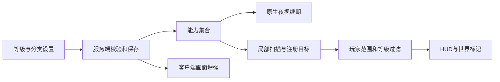

# PRD 评审与采用方案

原方案的核心需求是「自由切换、长期有效、跨生命周期恢复的视觉与感知能力」。七级体验可以保留；实现上应让等级选择能力集合，将视觉效果、目标发现、信息公开和显示分开管理。

## 关键改进

| 原方案中需要细化的点 | 采用方案 | 原因 |
|---|---|---|
| 更强的夜视效果 | Lv.2 使用原生夜视；Lv.1/3 使用可关闭的客户端色彩增强 | 夜视 amplifier 不是亮度阶梯，粒子也不会自动提高场景亮度 |
| 每 0.5～1 秒局部扫描 | 定时刷新玩家结果；方块分 8³ 单元增量查询、缓存复用 | 半径 24 的整立方体仍有 117,649 个方块，半径 32 有 274,625 个，不能一次逐块读完 |
| 统一隐藏目标扫描 | 实体标签/状态、方块白名单、其他模组主动注册三个来源 | 普通方块的外观无法证明它是秘密入口，私有任务变量无法自动推断 |
| Lv.4 与 Lv.5 的显示差异 | 服务端控制信息精度；Lv.4 不发送矿石类型、坐标、数量或含坐标的 ID | 只在 UI 隐藏精确数据不能形成可靠的信息边界 |
| 离开、死亡、换维度恢复 | 持久设置＋客户端就绪握手＋事件重建＋定时修复 | 引擎会在维度加载中销毁 HUD，仅保存等级不足以恢复界面 |
| 关闭所有夜视 | 仅撤销能确认属于天眼的效果，并恢复仍有效的外部效果 | 避免误删药水或其他模组的同名效果 |
| 最后做性能优化 | 扫描预算、缓存上限、结果上限从架构阶段加入 | 防止所有功能完成后才发现移动端无法承受 |

## 能力和数据流

玩家循环：选择等级 → 立即应用 → 看清环境/获得方向提示 → 接近目标 → 发现更多信息。Lv.0 随时关闭。高等级的信息增加，但不会扩大到未加载的世界。

服务端持有玩家设置、夜视效果管理、方块缓存和目标注册表；客户端持有界面、后处理和标记。状态与目标消息携带维度和修订号，旧消息不允许重建上一个世界的标记。目标只发给对应玩家。

共享代码和目录划分见 [implementation.md](implementation.md)。原 manifest UUID 保留；新增系统、消息、存档键及 UI 使用 `mercuryx_godeye` 命名空间。现有 `nightvision:*` 标签作为兼容协议保留。

## 实现参数

- 方块每 tick 最多执行 2 个分片任务，任务间检查 2 ms 预算；单次原生调用无法中断，此值不是总帧耗时保证。
- 每名玩家目标更新最多 2 Hz；每 tick 最多进行一名玩家的实体查询和结果聚合。
- 缓存最多 1,536 个单元，20 秒失效；方块事件提前失效；重叠玩家复用同维度缓存。
- 原生调色板为空不能直接视为无目标：地表上方用所有列的高度确认；地下空洞以每批 64 个方块完整回退读取。
- 最多向玩家发送 6/10/12 个目标，HUD 显示最近 4 个，Lv.6 增加世界标记。
- 夜视效果持续 45 秒，在剩余 25 秒以内提前续期，避开临结束闪烁；效果归属随世界保存。

这些参数是当前实现的初始预算。桌面实测结果不能代替目标手机上的分帧耗时、内存和长时间移动测试。

## 里程碑与验收

1. 基础视觉和界面：七级选中、立即应用、关闭、保存失败处理。
2. 状态恢复：死亡、重生、退出重进、维度往返；确认效果、HUD、标记均恢复。
3. 感知：原版/深层矿石、跨单元合并、隐身实体、标签实体、注册任务和可见玩家过滤。
4. 兼容和性能：与外部夜视共存，已有后处理保留，未加载区域与回退读取，移动端和真实多人验证。
5. 交付：导出两包、校验依赖和文件清单，确保开发探针不进入发布包。

当前进度和未验证项集中记录在 [acceptance.md](acceptance.md)，不把模拟引擎测试等同于真机完成。
